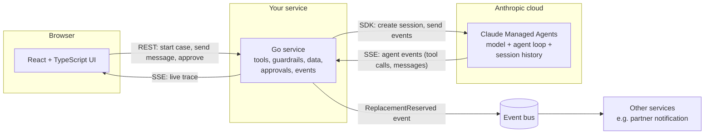
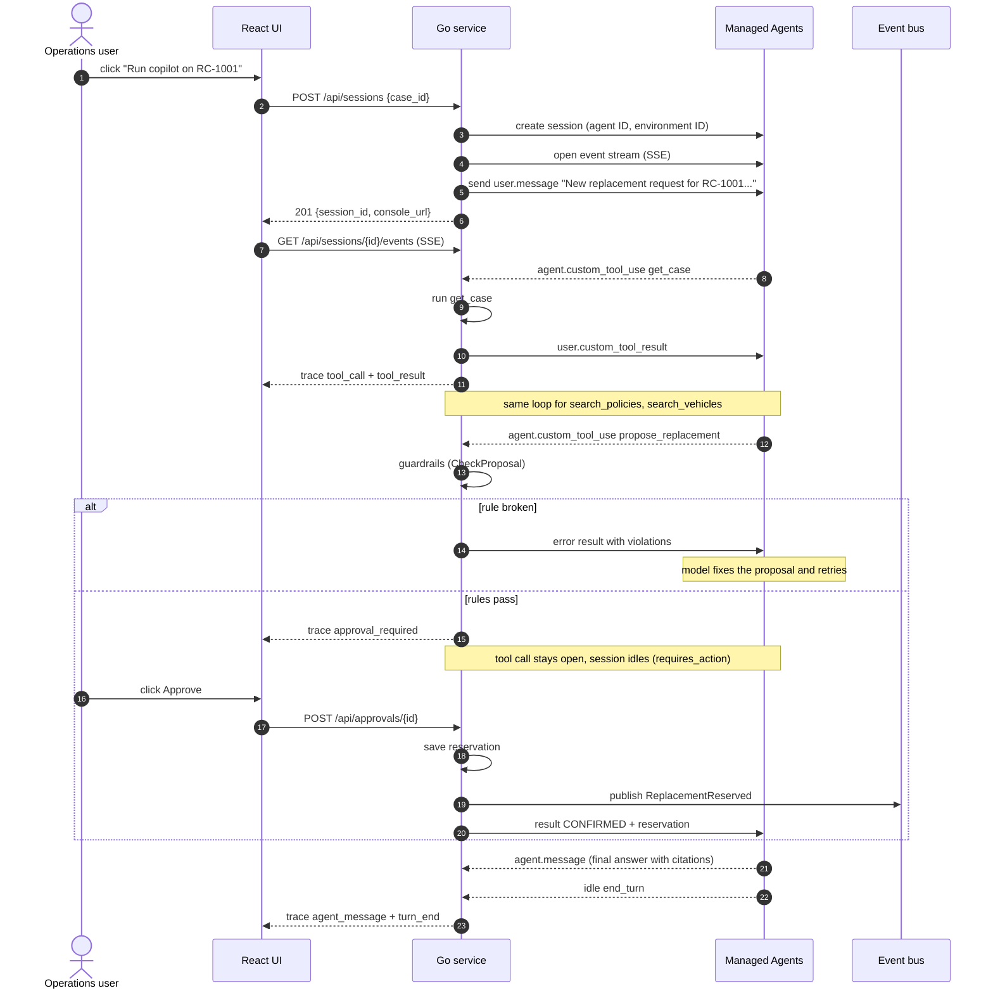
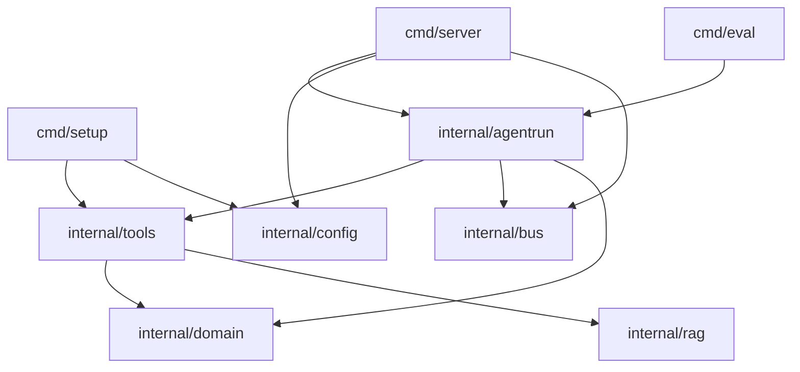

# Architecture study guide: a production-style AI agent with Go tools

This guide explains, from zero, how a **tool-using AI agent** is built around a backend service. The example is "Replacement Copilot", an agent that books a replacement car when a customer's own car is in repair. The domain is only a vehicle for the pattern. The same design works for claims handling, order support, IT ticket triage, or any process where an AI does the legwork and a person stays accountable.

**Who this is for:** you know web development (React, TypeScript, REST), but you have never written Go and you are new to AI agents. Every Go concept used in this repo is explained in [section 5](#5-go-for-a-typescript-developer), with TypeScript comparisons.

**How to read it:** sections 1-4 give the mental model and need no code knowledge. Sections 5-9 go into the code. Section 12 has self-check questions.

---

## Contents

1. [The problem and the pattern](#1-the-problem-and-the-pattern)
2. [The three parts and who owns what](#2-the-three-parts-and-who-owns-what)
3. [Concepts glossary](#3-concepts-glossary)
4. [The life of one case, step by step](#4-the-life-of-one-case-step-by-step)
5. [Go for a TypeScript developer](#5-go-for-a-typescript-developer)
6. [Package by package](#6-package-by-package)
7. [Concurrency: what runs at the same time](#7-concurrency-what-runs-at-the-same-time)
8. [Contracts: API, traces, tools, events](#8-contracts-api-traces-tools-events)
9. [Reliability details](#9-reliability-details)
10. [The frontend in one page](#10-the-frontend-in-one-page)
11. [Prototype vs production](#11-prototype-vs-production)
12. [Self-check questions](#12-self-check-questions)
13. [Suggested reading order of the code](#13-suggested-reading-order-of-the-code)

---

## 1. The problem and the pattern

### The business problem

An insurance or leasing company (the **partner**) pays for a rental car while its customer's car is repaired. Every partner has a **contract** with rules: which car category it pays for, for how many days, whether delivery is included. An operations person must pick a car that is free, in the right city, follows the contract, and fits the customer (for example "automatic only").

That is slow, repetitive work, and mistakes cost money (an upgrade the partner won't pay for) or anger customers (a downgrade).

### The pattern

> **The model reasons. The backend decides. A person approves.**

| Responsibility | Who does it | Why |
|---|---|---|
| Understanding the case, reading the contract, choosing a car, explaining why | The **AI model** | Language and judgement are what models are good at |
| Reading data, enforcing hard rules, writing bookings | The **backend (Go)** | Rules must be exact, tested and auditable. A prompt is not a guarantee |
| Final yes/no on anything that costs money | A **person** | Accountability stays with a human |
| Showing what happened and why | The **UI** | Users only trust what they can check |

The agent can't read the database or call any API on its own. It can only **ask** the backend to run one of four small, typed functions (the **tools**). Everything the agent knows comes back through those tools.

---

## 2. The three parts and who owns what



| Part | Runs where | Owns | Does **not** own |
|---|---|---|---|
| **React UI** | The user's browser | Display, user input (case choice, approve/reject, follow-up messages) | Secrets, business rules, data |
| **Go service** | Your machine (in production a container, e.g. on Kubernetes) | Data (cases, fleet, contracts), business rules, running tools, approvals, the Anthropic credentials, publishing domain events | The model or the conversation history |
| **Claude Managed Agents** | Anthropic's cloud | The model, the **agent loop** (call model → see tool request → wait for result → call model again), the session history, versioned agent configuration | Your data and your rules. It only sees what tools return |

**Why the browser never talks to Anthropic directly:** the API credential must stay on the server, and the server must run every tool so that the rules can't be skipped.

---

## 3. Concepts glossary

### AI concepts

| Term | Meaning |
|---|---|
| **LLM (model)** | A model that reads text and writes text. Here: Claude (`claude-opus-5-5`). |
| **System prompt** | Standing instructions the model gets before every conversation: its role, workflow and rules. Here: `tools.SystemPrompt`. |
| **Context / context window** | Everything the model can "see" when it writes its next reply: system prompt, tool definitions, conversation so far, tool results. It has a size limit and costs money per token, so you keep it small and relevant. |
| **Context management** | Deciding what goes into the context. Here: tools return compact JSON (not whole databases), policy search returns only the top 4 chunks, and the conversation history is stored by Managed Agents, not re-sent by our code. |
| **Tool (function calling)** | A function the model may ask to run. You describe it with a name, a description and a JSON schema for its input. The model replies "call `search_vehicles` with `{city: "Lisbon", ...}`", and *someone else* runs it and returns the result. The model never runs code itself. |
| **Custom tool** | A tool that **your** code runs (here: all 4, in Go). The opposite is a *built-in* tool such as bash or web search that Anthropic runs in a sandbox. This agent has none of those (least privilege). |
| **Agent** | A model plus a system prompt plus tools, running in a **loop**: think → call tool → read result → think again, until it has an answer. The model chooses which tool to call next. That's the difference from a fixed workflow. |
| **Multi-step orchestration** | Coordinating that loop over several tool calls: running tools, sending results back in the right order, handling parallel calls, waits, retries and failures. Here it lives in `internal/agentrun`. |
| **RAG (retrieval-augmented generation)** | Instead of putting every document in the prompt, you *search* for the relevant pieces and give only those to the model. Here: the agent calls `search_policies`, and Go returns matching contract sections. |
| **Chunk** | One searchable piece of a document. Here: one `## ` section of a contract markdown file, with a stable ID like `nordinsure-standard#rental-duration`. |
| **Citation** | The agent must quote chunk IDs in its answer (`[nordinsure-standard#rental-duration]`), so a person can check every claim against the source text. |
| **BM25** | A classic keyword-ranking formula (the basis of search engines like Elasticsearch). Scores a chunk higher when it contains rare query words often. The alternative is **embeddings**: vectors that capture meaning, so "how long" can match "duration". Production systems often combine both (*hybrid search*). |
| **Guardrail** | A check that limits what the AI can do. Here the important ones are **deterministic**: Go code (`CheckProposal`) that rejects a booking that breaks a rule, whatever the model says. |
| **Human in the loop (HITL)** | A person approves an action before it takes effect. Here: every booking. |
| **Evaluation (eval)** | Automated tests for agent behaviour. You run fixed scenarios and check the outcome and the steps. Agents are non-deterministic, so in production you run each scenario many times and measure a pass rate. |
| **Hallucination** | The model stating something that isn't true. Countered here by: "use only tool results" in the prompt, citations, and guardrails that verify facts (does this vehicle exist? is it free?). |

### Claude Managed Agents concepts

| Object | Meaning | Lifetime |
|---|---|---|
| **Agent** | Stored configuration: name, model, system prompt, tool definitions. **Versioned**: each update creates version 2, 3, and so on. | Create once, reuse its ID. Created by `cmd/setup`. |
| **Environment** | The container configuration a session runs in (networking, packages). Required even though this agent uses no sandbox tools. Here networking is limited and package managers are off. | Create once. |
| **Session** | One running conversation of an agent in an environment. Anthropic stores its full history. Here: one session per case. | One per case run. |
| **Event** | Everything in a session is an event with an ID and a type: `user.message`, `agent.message`, `agent.custom_tool_use`, `user.custom_tool_result`, status changes (`running`, `idle`), errors. You *send* `user.*` events and *receive* the rest. |  |
| **Idle with `requires_action`** | The session paused because it's waiting for your tool result. Not the end of the turn. | Until you send the result. |
| **Idle with `end_turn`** | The agent finished its answer and waits for the next user message. |  |

### Architecture concepts

| Term | Meaning |
|---|---|
| **Microservice** | A small service that owns one business capability and its data, deployed on its own. Here everything is one process for simplicity, but the packages are cut the way services would be (see section 11). |
| **Cloud-native** | Built to run in containers on a cloud platform: stateless where possible, configured from the environment, scales by adding copies, starts fast. |
| **Control plane vs data plane** | *Control plane* = setting things up (create/version the agent: `cmd/setup`). *Data plane* = the traffic that does real work (sessions, tool calls: `cmd/server`). Kept apart so normal traffic can't change configuration. |
| **Event-driven** | Services react to **events** ("a reservation was made") instead of calling each other directly. The producer doesn't know who listens. |
| **Domain event** | An event named in business language, past tense: `ReplacementReserved`. |
| **Event bus / message broker** | The system that carries events between services (Kafka, RabbitMQ, cloud pub/sub). Here: `internal/bus`, an in-process stand-in. |
| **SSE (Server-Sent Events)** | A long-lived HTTP response where the server keeps writing `data: ...` lines. One direction only (server → client). Used twice here: Anthropic → Go, and Go → browser (`EventSource` in JS). |
| **Idempotency / dedupe** | Processing the same thing twice has the same effect as once. Needed because reconnects can deliver an event again. |

---

## 4. The life of one case, step by step

This follows case **RC-1001** from the click to the confirmed booking. Every step names the file and function so you can read along.



### In words

1. **Start.** The user picks a case and clicks *Run*. `useSession.start` (frontend) sends `POST /api/sessions {"case_id": "RC-1001"}`.
2. **Create the session.** `server.createSession` (`cmd/server/main.go`) creates a **hub** (the fan-out for this session's trace, see section 6.9) and calls `agentrun.Start`. That calls the Anthropic SDK `Sessions.New` with the agent ID and environment ID saved in `agent.json` by `cmd/setup`.
3. **Open the stream first.** `Start` launches a background goroutine `pump` that opens the session's event stream, and waits until it is open (`<-ready`). Why: the stream has no replay, so it must be listening *before* anything happens.
4. **Kick off.** The server sends the first user message ("New replacement request for case RC-1001..."). `Session.Send` also emits a `user` trace so the UI shows it.
5. **Browser subscribes.** The browser gets `session_id` back and opens `EventSource('/api/sessions/{id}/events')`. `server.streamEvents` first sends the backlog (everything so far), then each new trace live.
6. **Anthropic runs the loop.** Managed Agents calls the model with the system prompt, the 4 tool definitions and the message. Following the prompt's workflow, the model asks for `get_case`. Because it's a *custom* tool, Anthropic doesn't run it: it emits an `agent.custom_tool_use` event and the session goes **idle with `requires_action`**.
7. **Go runs the tool.** `streamOnce` receives the event and calls `dispatch`. `dispatch` starts a **goroutine** that:
   - emits a `tool_call` trace (timeline shows "running…"),
   - runs `Deps.Execute("get_case", input)` → `Store.Case("RC-1001")`,
   - JSON-encodes the result and sends it as `user.custom_tool_result` with the same tool-use ID,
   - emits a `tool_result` trace with the duration.
8. **More steps.** The model reads the case and calls `search_policies` ("NordInsure category cap"), and Go answers with the top BM25 chunks. Then `search_vehicles` (Lisbon, 2026-12-01), and Go returns free cars. The model notices the nearest branch has no COMPACT, but the other Lisbon branch does.
9. **Propose.** The model calls `propose_replacement` with a vehicle, dates, days, `customer_copay` and a justification.
10. **Guardrails.** `Execute` builds a `ProposalInput` and calls `Store.CheckProposal`. That's plain Go: does the car exist, is it free, same city, no downgrade, within the policy cap (unless co-pay), within max days, automatic if needed, justification present?
    - **Fails:** the result is an error with readable violations (for example "12 days exceeds the NI-STD maximum of 10 days; propose the maximum and flag an extension request"). The model reads it, corrects the proposal and calls again. The timeline shows *Guardrails: blocked*.
    - **Passes:** go on to step 11. The timeline shows *Guardrails: passed*.
11. **Wait for a person.** `humanInTheLoop` emits `approval_required` (the UI shows an approval card) and calls `UIApprover.Approve`, which **blocks** that goroutine on a channel. The tool call stays open, so the session stays idle with `requires_action`. Nothing is lost while it waits. Other goroutines (the stream reader, the HTTP server) keep running.
12. **Approve.** The user clicks *Approve*. `POST /api/approvals/APR-xxxx` → `server.resolveApproval` → `UIApprover.Resolve` sends the decision into the channel. The blocked goroutine wakes up.
13. **Commit and publish.** `Store.Confirm` marks the car reserved and creates `RES-5001`. `bus.Publish("ReplacementReserved", reservation)` notifies subscribers (the server logs `[bus] ... consumed by partner-notification-svc`). A `domain_event` trace goes to the UI, which refetches *Confirmed reservations*.
14. **Report back to the agent.** The tool result `{"status": "CONFIRMED", "reservation": ...}` goes to Anthropic. If the user *rejected* it, the result is `REJECTED_BY_HUMAN` with their note, and the model reacts to that note.
15. **Final answer.** The model writes the summary (Decision / Vehicle / Why / Open points, with citations). It arrives as `agent.message` → `agent_message` trace → the conversation shows it with citation chips. Then the session goes idle with `end_turn` → `turn_end` trace → status pill shows *idle*.
16. **Follow-ups.** Messages typed in the composer go `POST /api/sessions/{id}/messages` → `Session.Send`, and the loop continues in the same session, with full history.

---

## 5. Go for a TypeScript developer

Only the Go features this repo uses, each with a TypeScript comparison and a real line from the code.

### 5.1 Modules, packages, imports, exports

| Go | TypeScript equivalent |
|---|---|
| `go.mod` (`module replacement-copilot`) | `package.json` |
| `go.sum` | `package-lock.json` |
| `go mod tidy` | `npm install` (adds missing, removes unused) |
| A **package** = one folder; all `.go` files in it share scope | Roughly one module/folder with an `index.ts` |
| `import "replacement-copilot/internal/domain"` then `domain.NewStore()` | `import * as domain from "./internal/domain"` |
| **Capitalised** name = exported (`NewStore`, `Store`), lowercase = private (`seedCases`, `tokenize`) | `export` keyword |
| `internal/` folder: importable only from inside this module (enforced by the compiler) | No direct equivalent |
| `cmd/<name>/main.go` with `package main` and `func main()` = a runnable program | A script in `package.json` `"bin"` |
| `go run ./cmd/server` | `npx tsx src/server.ts` |

### 5.2 Structs (data shapes) and struct tags

A struct is a named group of fields, like a TS `interface` but it's also the actual value.

```go
type Vehicle struct {
    ID        string   `json:"id"`
    Category  Category `json:"category"`
    Automatic bool     `json:"automatic"`
    Reserved  bool     `json:"-"`         // never sent as JSON
}
```
```ts
interface Vehicle { id: string; category: string; automatic: boolean }
```

The text in backticks is a **struct tag**: metadata for the JSON encoder (field name, `omitempty` = skip if empty, `-` = never include). The Go name is capitalised so the encoder can see it, and the tag gives it the snake_case JSON name the frontend uses.

### 5.3 Methods and receivers

A method is a function attached to a type. The "receiver" `(s *Store)` is like `this`.

```go
func (s *Store) Case(id string) (Case, bool) { ... }
// called as: store.Case("RC-1001")
```

### 5.4 Pointers: `*` and `&`

- `&x` = "the address of x" (a reference to it). `*Store` = "a pointer to a Store".
- In TS, objects are always passed by reference. In Go, structs are **copied** unless you pass a pointer.
- So `NewStore()` returns `*Store`: everyone shares the same store, and changes are visible everywhere. `Vehicle(id)` returns a `Vehicle` **copy** on purpose, so callers can't change the fleet by accident.
- `nil` is Go's `null` for pointers, maps, slices, channels and interfaces.

### 5.5 Zero values and optional fields

Every Go variable starts with a **zero value**: `""`, `0`, `false`, `nil`. There's no `undefined`.

So how do you say "no filter"? With a pointer that may be `nil`:

```go
type VehicleQuery struct {
    MinCategory *Category // nil = not given
    Automatic   *bool     // nil = don't care; &true / &false = filter
}
```
```ts
interface VehicleQuery { minCategory?: Category; automatic?: boolean }
```

### 5.6 Errors are values (no exceptions)

Functions return the error as a normal second value. You check it right away.

```go
cfg, err := config.Load()
if err != nil {
    log.Fatal(err)
}
```
```ts
try { cfg = loadConfig() } catch (err) { console.error(err); process.exit(1) }
```

A related idiom is **comma-ok**: return `(value, found bool)` instead of `undefined`.

```go
c, ok := d.Store.Case(id)
if !ok { return errorf("case %q not found", id) }
```

`fmt.Errorf("create session: %w", err)` wraps an error with context (like `new Error("create session", { cause: err })`), and `errors.Is(err, os.ErrNotExist)` checks the cause.

### 5.7 Interfaces are implicit (like TS structural typing)

```go
type Approver interface {
    Approve(ctx context.Context, sessionID, approvalID string, p domain.ProposalInput) (approved bool, by, note string)
}
```

`UIApprover` and `AutoApprover` never say "implements Approver". They just have an `Approve` method with that signature, so they qualify. TypeScript works the same way (structural typing). This is how the eval swaps the human for an auto-approver without changing `agentrun`.

### 5.8 `any`, maps and type assertions

Tool input arrives as JSON the model wrote, so its shape isn't known at compile time:

| Go | TypeScript |
|---|---|
| `map[string]any` | `Record<string, unknown>` |
| `s, ok := in["city"].(string)` (**type assertion**) | `typeof in.city === "string"` |
| `switch v := x.(type) { case float64: ... }` (**type switch**) | `if (typeof x === "number") ...` |

Gotcha: JSON numbers decode as `float64`, which is why `num()` in `tools.go` converts `float64` to `int`.

### 5.9 Slices and maps

| Go | TypeScript |
|---|---|
| `[]Vehicle` (slice) | `Vehicle[]` |
| `out = append(out, v)` | `out.push(v)` (append may return a new slice, so you always reassign) |
| `map[string]Case` | `Map<string, Case>` or an object |
| `for i, v := range list { }` | `list.forEach((v, i) => ...)` |
| `append([]Reservation(nil), s.reservations...)` | `[...s.reservations]` (a copy) |

### 5.10 Enums with `const` and `iota`

```go
type Category int
const (
    Mini Category = iota // 0
    Economy              // 1
    Compact              // 2
    ...
)
```

Like a numeric TS `enum`. Because categories are ordered numbers, "no downgrade" is just `car.Category < c.OwnCategory`. The `MarshalText` method makes JSON show `"COMPACT"` instead of `2`.

### 5.11 `defer`

`defer x()` runs `x` when the function returns, whatever path it takes. It's like `finally`.

```go
s.mu.Lock()
defer s.mu.Unlock() // always unlocks, even on early return
```

### 5.12 Goroutines: real parallel work

`go f()` starts `f` running **at the same time** as the current code, and returns immediately.

| JavaScript | Go |
|---|---|
| One thread. `async` code takes turns on the event loop. A long CPU loop freezes everything. | Many goroutines spread across all CPU cores. One blocked goroutine doesn't stop the others. |
| `await` = "pause me until this resolves" | A goroutine just *blocks* (on network, a channel, a lock) and the runtime runs others meanwhile |
| Promises are cheap | Goroutines are cheap too (a few KB each), so thousands are normal |

In this repo: one goroutine per HTTP request (`net/http` does that for you), one per session stream (`go s.pump(...)`), one per tool call (`dispatch`), one per bus subscriber per event.

### 5.13 Channels: typed pipes between goroutines

A channel `chan T` passes values of type `T` from one goroutine to another.

```go
ch := make(chan decision, 1) // buffered, holds 1
ch <- decision{...}          // send (in Resolve, from the HTTP handler)
d := <-ch                    // receive; blocks until something arrives (in Approve)
```

TS analogy: a Promise whose `resolve` you hand to someone else (a "deferred"). `Approve` is `await new Promise(resolve => pending[id] = resolve)`, and `Resolve` calls `pending[id](decision)`.

`close(ready)` on a `chan struct{}` is a broadcast signal: every `<-ready` wakes up. `struct{}` is an empty value of size zero, used when only the signal matters.

### 5.14 `select`: wait for the first of several things

```go
select {
case d := <-ch:            return d.approved, d.by, d.note        // human decided
case <-time.After(15*time.Minute): return false, "system", "timeout" // nobody did
case <-ctx.Done():         return false, "system", "server shutting down"
}
```

Like `Promise.race([decision, timeout(15min), abortSignalPromise])`.

A `select` with a `default:` branch never waits. In `hub.publish` it means "send if the client has room, otherwise skip", so one slow browser can't block the agent.

### 5.15 Mutexes: protecting shared data

JavaScript never needs locks, because only one piece of code runs at a time. In Go, two goroutines **can** touch the same map at the same moment, which corrupts it (Go even crashes on purpose when it detects this).

```go
type Store struct {
    mu       sync.Mutex
    vehicles []*Vehicle
}
func (s *Store) Confirm(...) {
    s.mu.Lock()
    defer s.mu.Unlock()
    // only one goroutine at a time gets here
}
```

`sync.RWMutex` (in `bus`) allows many readers or one writer. `sync.Once` (in `pump`) runs something at most once, used so `ready` is closed only once.

### 5.16 `context.Context`: cancellation and deadlines

A `ctx` is passed as the first argument through every call that may wait. It carries a "stop" signal and an optional deadline.

TS analogy: an `AbortSignal` passed down to every `fetch`.

An important detail in `createSession`:

```go
// s.ctx, not r.Context(): the session must outlive this request.
sess, err := agentrun.Start(s.ctx, ...)
```

`r.Context()` is cancelled when the HTTP request ends (milliseconds later). The session must keep running for minutes, so it uses the server's context `s.ctx`, which is only cancelled on Ctrl+C (`signal.NotifyContext`). Using the wrong context here is a classic Go bug: the stream would close as soon as the response was sent.

### 5.17 Closures and function values

Functions are values, like in JS. `emit func(Trace)` is a callback: the server passes `h.publish`, the eval passes a function that collects traces. `agentrun` doesn't know or care who listens.

### 5.18 `//go:embed`

```go
//go:embed policies/*.md
var policyFS embed.FS
```

Bakes the markdown files into the compiled binary at build time. It's like Vite's `import text from "./file.md?raw"`, so the binary needs no files next to it at runtime.

### 5.19 HTTP with the standard library

```go
mux := http.NewServeMux()
mux.HandleFunc("POST /api/sessions/{id}/messages", s.sendMessage)
```
```ts
app.post("/api/sessions/:id/messages", sendMessage) // Express
```

| Go | Express |
|---|---|
| `func (w http.ResponseWriter, r *http.Request)` | `(req, res) => {}` |
| `r.PathValue("id")` | `req.params.id` |
| `json.NewDecoder(r.Body).Decode(&body)` | `req.body` (with `express.json()`) |
| `http.Error(w, "msg", 400)` | `res.status(400).send("msg")` |
| `w.(http.Flusher).Flush()` | `res.flush()` (push buffered SSE data now) |

There's no framework. Routing with methods and `{id}` patterns is built into Go since 1.22.

### 5.20 Everyday commands

| Command | Does |
|---|---|
| `go run ./cmd/server` | Compile and run |
| `go build ./...` | Compile everything (catches type errors, like `tsc`) |
| `go vet ./...` | Lint for common bugs |
| `gofmt -w .` | Format (like Prettier, but there's only one style) |
| `go test ./...` | Run tests (`*_test.go` files) |
| `go run -race ./cmd/server` | Run with the race detector, which reports unsafe shared-data access |

---

## 6. Package by package



Arrows point from "uses" to "used by nothing below". The **domain has no dependencies**: business rules don't know about HTTP, Anthropic or the UI. That's a clean-architecture principle: the core is the most stable part, and the edges (`cmd/*`) wire everything together.

### 6.1 `internal/domain`: business data and rules

**Job:** the car-replacement world: cases, partner policies, fleet, reservations, and the guardrail.

**Key pieces**
- `Category`: ordered enum (section 5.10).
- `Policy`: the *structured* contract (`MaxCategory`, `MaxDays`, `DeliveryAllowed`).
- `Case`, `Vehicle`, `Reservation`, `ProposalInput`.
- `Store`: in-memory data with a mutex. `NewStore()` loads the seed data from `seed.go`.
- `SearchVehicles(VehicleQuery)`: filters free cars. It uses a `switch` with empty cases to mean "skip this car".
- `CheckProposal(ProposalInput) []string`: **the guardrail.** It returns a list of human-readable violations, and an empty list means allowed.
- `Confirm(...)`: re-checks the car isn't reserved (under the lock), marks it reserved and creates the reservation.

**Why it's built this way**
- **The policy exists twice on purpose:** as prose in `internal/rag/policies/*.md` (what the model *reasons* with) and as a struct (what Go *enforces*). The model might misread the prose, but it can't get past the struct check.
- Violations are written as **instructions** ("propose the maximum and flag an extension request"), so the model can fix itself on the next try.
- `Confirm` checks `Reserved` again because time passes between the check and the human click. Two sessions could propose the same car.

### 6.2 `internal/rag`: retrieval over the contracts

**Job:** find the contract sections relevant to a question.

**How it works**
1. `Load()` reads the embedded markdown files. Each `## Section` becomes a `Chunk` with ID `<file>#<slug(section)>`.
2. Each chunk is tokenised: lowercase, split on non-letters, drop short and stop words, and a naive stem ("days" → "day"). Term counts are stored.
3. `Search(query, partner, k)` scores every chunk with **BM25** and returns the top `k`. Roughly, a chunk scores higher when:
   - it contains the query words more often (with diminishing returns: `k1 = 1.2`),
   - those words are rare across all chunks (*IDF*, inverse document frequency),
   - it's not unusually long (length normalisation: `b = 0.75`).
4. With a `partner` filter, only that partner's contract and the shared `ops-playbook` are searched. That's simple **context management**: less irrelevant text reaches the model.

**Why so simple:** with 3 short documents, keyword search is enough and runs offline. The *contract* with the agent (a query goes in, short cited chunks come out) is what matters. You could swap in embeddings and a vector database without changing the tool.

### 6.3 `internal/tools`: what the agent may do

**Job:** define the 4 tools (for Anthropic) and run them (in Go). It also holds the system prompt.

| Tool | Input | What Go does | Side effects |
|---|---|---|---|
| `get_case` | `case_id` | `Store.Case` | none |
| `search_policies` | `query`, optional `partner` | `Index.Search(..., 4)` | none |
| `search_vehicles` | `city`, `available_on`, optional category range, `automatic` | validates categories, `Store.SearchVehicles` | none |
| `propose_replacement` | `case_id`, `vehicle_id`, `start_date`, `days`, `customer_copay`, `justification` | `Store.CheckProposal` → violations, or a `Proposal` for human approval | **booking** (only after approval, in `agentrun`) |

**Key pieces**
- `SystemPrompt`: role, step-by-step workflow, rules (never invent, never downgrade, never assume co-pay, cite chunks) and the final answer format.
- `Definitions()`: JSON schemas. Descriptions are written *for the model*, because they're how it decides which tool to use and how.
- `ForCreate()` / `ForUpdate()`: wrap the same definitions in the two SDK types needed for creating and updating an agent.
- `Execute(ctx, name, input) Result`: a `switch` on the tool name. Input is validated (required fields, known categories) and bad input returns an error result the model can read.
- `Result`: `Output` (sent to the model), `IsError`, `Violations` (for the UI), and `Proposal` (set when a person must decide).

**Why it's built this way:** only read-only tools plus one write tool, and the write tool is guarded twice (code rules, then a person). The tool layer is the agent's whole **permission model**.

### 6.4 `internal/agentrun`: the orchestrator (the heart)

**Job:** drive one Managed Agents session: read its events, run tool calls, handle approval, send results, and turn everything into a single `Trace` stream for the UI or the eval.

**Key pieces**
- `Trace`: the one event schema the outside world sees (section 8.2).
- `Start(...)`: creates the session, starts `pump` in a goroutine, waits for `ready`.
- `Send(ctx, text)`: sends a `user.message`.
- `pump`: loops `streamOnce` with a back-off (1s, 2s, ... up to 5s) until the session is terminated or the server stops.
- `streamOnce`:
  1. open the live stream,
  2. **list the history** of past events,
  3. mark every tool use that already has a result as handled,
  4. replay unseen history (messages and unresolved tool calls),
  5. read live events: messages → `agent_message`, tool uses → `dispatch`, status → `status`/`turn_end`, errors → `error`.
- `dispatch`: skips if already handled, otherwise runs the tool **in a new goroutine**, so the stream reader never waits for a tool, a slow search or a person.
- `humanInTheLoop`: approval card → wait → confirm → publish event → build the result for the model.
- `markSeen` / `markHandled`: mutex-protected sets for **dedupe** (section 9).

**Why it's built this way:** this is the "multi-step orchestration" part. Anthropic runs the agent *loop*, but the client still has to: answer every tool call exactly once, keep reading while tools run, survive dropped connections, and make long waits (a person) safe.

### 6.5 `internal/agentrun/approver.go`: human approval

**Job:** turn "wait for a click in a browser" into a normal blocking function call.

- `UIApprover.Approve` creates a channel, stores it under the approval ID, and `select`s on: a decision, a 15-minute timeout, or server shutdown.
- `UIApprover.Resolve` (called by the HTTP handler) finds the channel and sends the decision.
- `AutoApprover` always says yes. It's used by the eval.

The approval isn't a separate workflow. The agent just sees a slow tool call whose result is the human's decision and note. That keeps the agent loop simple and puts the human's feedback directly into the model's context.

### 6.6 `internal/bus`: domain events

**Job:** publish `ReplacementReserved` to anyone who subscribed, without knowing who they are.

`Publish` runs each subscriber in its own goroutine (asynchronous, like a real consumer). The server subscribes a fake "partner notification service" that just logs.

**In production:** Kafka or similar, plus the **outbox pattern**: write the reservation and the event to the database in one transaction, and a relay publishes the event. That avoids "booked but nobody was told" if the process crashes between the two.

### 6.7 `internal/config`: agent IDs

Reads and writes `agent.json` (`agent_id`, `agent_version`, `environment_id`). It isn't committed, because it's specific to your Anthropic account.

### 6.8 `cmd/setup`: control plane

- First run: creates the environment (limited networking, no package managers, no MCP), then the agent (name, model, system prompt, 4 custom tools), and saves the IDs.
- Later runs: `Agents.Update` with the current version, which creates **a new version**. Sessions already running keep their version.

That's **configuration as code**: the prompt and tool schemas live in git and are reviewed like code, and every change is a new, traceable agent version.

### 6.9 `cmd/server`: data plane and HTTP API

- `main`: loads config and the RAG index, sets up Ctrl+C handling (`signal.NotifyContext`), creates the bus, the store, the approver, registers routes and listens on `:8080`.
- `hub` (one per session): keeps the whole trace history, assigns `Seq` numbers, fans each trace out to every subscribed browser tab, and never blocks on a slow tab.
- Handlers: see section 8.1. `streamEvents` is a plain SSE writer: backlog first, then live, and it stops when the browser disconnects (`r.Context().Done()`).
- `conv` map: session ID → session + hub + case ID, protected by a mutex.

### 6.10 `cmd/eval`: behaviour tests

Runs each scenario (RC-1001..1003) as a real session with a **fresh store** and the `AutoApprover`, waits for `turn_end` (6-minute timeout), then checks the collected traces and the resulting booking:

- **Process checks:** loads the case first, reads policy before proposing, cites chunk IDs.
- **Outcome checks:** ends with a confirmed reservation, right category (RC-1001), automatic (RC-1002), ≤ 10 days, no co-pay, and mentions the extension (RC-1003).

All checks are **deterministic** (string and field checks, no model judging), so a failure points at a specific behaviour.

---

## 7. Concurrency: what runs at the same time

During one case run, these goroutines are alive:

```
main goroutine ─ http.Server.ListenAndServe
│
├─ goroutine per HTTP request (net/http does this)
│    ├─ POST /api/sessions          → returns quickly
│    ├─ GET  /events (SSE)          → lives as long as the browser tab
│    └─ POST /api/approvals/{id}    → sends into the approval channel, returns
│
├─ pump (one per session)            → reads Anthropic's SSE stream, reconnects
│    └─ dispatch goroutine per tool call
│         └─ (propose_replacement) blocks in Approve until the click
│
└─ bus subscriber goroutine per published event
```

**Shared data and its protection**

| Shared data | Touched by | Protected by |
|---|---|---|
| `Store` (cases, fleet, reservations) | tool goroutines, HTTP handlers | `Store.mu` |
| `hub.history`, `hub.subs` | `emit` from any goroutine, SSE handlers | `hub.mu` |
| `Session.seen`, `Session.handled` | stream reader, dispatch | `Session.mu` |
| `UIApprover.pending` | Approve (tool goroutine), Resolve (HTTP) | `UIApprover.mu` |
| `server.convs` | HTTP handlers | `server.mu` |

**The main rule: the stream reader must never wait.** If `streamOnce` ran tools itself, a person taking 3 minutes to click *Approve* would mean 3 minutes of unread events, missed parallel tool calls and possible timeouts. So every tool runs in its own goroutine, and every fan-out (`hub.publish`, `bus.Publish`) is non-blocking.

---

## 8. Contracts: API, traces, tools, events

### 8.1 HTTP API (Go ↔ browser)

| Method and path | Body | Response | Purpose |
|---|---|---|---|
| `GET /api/cases` | | `Case[]` | List demo cases |
| `GET /api/reservations` | | `Reservation[]` | Confirmed bookings |
| `POST /api/sessions` | `{case_id}` | `201 {session_id, console_url}` | Start the agent on a case |
| `POST /api/sessions/{id}/messages` | `{text}` | `202` | Follow-up message |
| `GET /api/sessions/{id}/events` | | SSE stream of `Trace` | Live trace (backlog first) |
| `POST /api/approvals/{id}` | `{approved, note}` | `204` (or `404` if not pending) | Human decision |

### 8.2 `Trace`: the one schema for everything the agent does

| `kind` | Emitted by | Means | Shown in UI by |
|---|---|---|---|
| `user` | `Session.Send` | A message to the agent | `MessageItem` (conversation) |
| `agent_message` | stream reader | Agent text | `MessageItem` + `RichText` (citation chips) |
| `status` | stream reader | running / waiting for tool results / reconnecting / terminated | `StatusPill` |
| `tool_call` | `dispatch` | Tool started (name + input) | `TimelineItem` |
| `tool_result` | `dispatch` | Tool finished (output, error flag, duration) | `TimelineItem` + `ToolOutput` |
| `guardrail` | `dispatch` | Passed or blocked + violations | `GuardrailVerdict` |
| `approval_required` | `humanInTheLoop` | Waiting for a person | `ApprovalCard` |
| `approval_resolved` | `humanInTheLoop` | Approved/rejected + note | `ApprovalOutcome` |
| `domain_event` | `humanInTheLoop` | `ReplacementReserved` published | system line + reservations refresh |
| `turn_end` | stream reader | Agent finished its answer | `StatusPill` → idle |
| `error` | anywhere | Something failed | red line in the conversation |

`seq` (assigned by the hub) gives a total order and is the frontend's dedupe key. `tool_use_id` links `tool_call`, `tool_result` and `guardrail` for the same call.

This is a key design choice: the **Anthropic event format stays inside `agentrun`**. The UI and the eval depend only on `Trace`. If the provider's API changes, one package changes.

### 8.3 Managed Agents events (Go ↔ Anthropic)

| Direction | Event | Handled where |
|---|---|---|
| Go → Anthropic | `user.message` | `Session.Send` |
| Go → Anthropic | `user.custom_tool_result` (tool-use ID, error flag, JSON text) | `dispatch` |
| Anthropic → Go | `agent.message` | `emitAgentText` |
| Anthropic → Go | `agent.custom_tool_use` (ID, name, input) | `dispatch` |
| Anthropic → Go | status running / idle (`requires_action` or end of turn) / terminated, errors | `streamOnce` switch |

---

## 9. Reliability details

### Stream reconnect without losing or repeating work

The SSE stream from Anthropic only delivers events from the moment you connect. If the connection drops while a tool call is pending and you just reconnect, you never see that call again, and the session waits forever.

The fix, in `streamOnce`, on **every** connect:
1. **Open the live stream first** (so nothing new is missed),
2. **list the full history** (to catch up on what happened while disconnected),
3. note every tool call that **already has a result**,
4. process unseen history events, running only tool calls that never got a result,
5. continue with live events, skipping any event ID already seen (the overlap between history and live).

`seen` makes event processing idempotent. `handled` guarantees each tool call is answered **once**.

### Long waits

- The approval waits up to 15 minutes, then returns a rejection with "no human decision within the timeout", so the agent can say so instead of hanging.
- Ctrl+C cancels `s.ctx`, so every pending approval returns "server shutting down" and the streams close.

### Slow browsers

`hub.publish` uses a non-blocking send to a 256-slot buffer per tab. A frozen tab loses live updates but never blocks the agent, and it gets everything back from the backlog when it reconnects.

### Known limits of the prototype

- All state is in memory: a restart loses sessions, pending approvals and reservations.
- One process: no horizontal scaling (the hub and approvals would need shared storage, such as Redis or a database).
- No auth on the API.

---

## 10. The frontend in one page

```
src/
  App.tsx        layout only, wires hooks to components
  types.ts       TypeScript copy of the Go Trace / domain structs
  hooks/
    useSession   POST /api/sessions, holds session + status, exposes start()
    useTraces    EventSource on /events, dedupes by seq
    useFetch     GET JSON, refetch when deps change
  lib/           post(), formatArgs()
  components/    small functional components, one per file
```

- **One stream, two views.** The same `Trace[]` feeds the **Conversation** (business view: messages, approval card, outcome) and the **Timeline** (transparency view: each tool call with input, duration, guardrail verdict and readable output).
- `Timeline` joins traces by `tool_use_id`: for each `tool_call` it looks up the matching `tool_result` and `guardrail`.
- `MessageItem` and `ToolOutput` are small `switch` components: one trace kind or tool name → one component. A new tool gets readable output by adding one component.
- The reservation list refetches whenever the number of `domain_event` traces changes. It's a simple "react to events" in the UI.
- `RichText` renders `**bold**`, bullets and `[doc#section]` as citation chips **without** `dangerouslySetInnerHTML`. Model output is never injected as HTML.

---

## 11. Prototype vs production

| Concern | Prototype | Production |
|---|---|---|
| Data | In-memory `Store` with seed data | Separate services (case management, fleet availability, partner contracts) with their own databases |
| Service cut | One Go process | Copilot service (agentrun + tools) calling domain services over HTTP/gRPC with timeouts, retries, idempotency keys |
| Retrieval | BM25 over 3 embedded files | Embeddings + vector store (e.g. pgvector), hybrid search, re-ranking, retrieval quality evals, document versioning |
| Events | In-process `bus` | Kafka (or similar) + outbox pattern + idempotent consumers |
| Session state | In memory | Session IDs and approvals in a database; any instance can resume a session (the history is at Anthropic anyway) |
| Human approval | Channel in memory, 15-min timeout | Task queue / work-item system, audit log, roles and permissions |
| Long sessions | Long-lived SSE stream | Webhooks or a worker that resumes on events |
| Observability | Log lines + the trace UI | OpenTelemetry traces across service and sessions, metrics (tool latency, guardrail rejection rate, approval rate, cost per case) |
| Cost and safety | Trust | Per-session spend caps, rate limits per tenant, PII handling |
| Evals | 3 scenarios, run by hand | Many anonymised real cases, repeated runs for pass rate, LLM-judged answer quality, run in CI before every agent version bump |
| Deployment | `go run` | Container image (a small static binary), Kubernetes, config from environment/secrets manager |

---

## 12. Self-check questions

Try to answer them yourself first. The short answers follow.

1. **Why doesn't the model call the database directly?**
   Least privilege and control. Tools are the only door, they validate input, and the one write action is checked by code and approved by a person.

2. **The prompt already says "never downgrade". Why also check it in Go?**
   A prompt is a request, not a guarantee. Models can misread or be manipulated (for example by text inside a customer note). Code rules are exact, testable and auditable.

3. **What happens if the model proposes 12 days on a 10-day policy?**
   `CheckProposal` returns a violation that tells the model what to do. The tool result is an error, the model retries with 10 days and flags an extension. The UI shows *blocked*, then *passed*.

4. **How does the agent "wait" for a person without blocking the server?**
   The tool call stays open. Its goroutine blocks on a channel, other goroutines keep running, and the session idles with `requires_action`. The click sends into the channel.

5. **Why open the stream before listing history?**
   The stream has no replay. Listing first would leave a gap where events could be missed.

6. **Why does `createSession` use `s.ctx` and not the request's context?**
   The request context is cancelled when the response is sent, and the session must keep running after that.

7. **What's the difference between a tool error and a guardrail rejection?**
   Both come back as error results to the model. A tool error is bad input or a missing record. A guardrail rejection is a valid request that breaks a business rule, and it carries specific instructions for fixing it.

8. **Why a separate `Trace` schema instead of forwarding Anthropic events?**
   It decouples the UI and the eval from the provider, adds our own events (guardrail, approval, domain event), and gives one ordered, deduplicated stream.

9. **How would you roll out a new prompt safely?**
   Change it in git, run `cmd/setup` (new agent version), run the eval and compare to the last run, then switch traffic. Roll back by pinning to the previous version.

10. **Why are evals deterministic here, and when would you add an LLM judge?**
    Deterministic checks give clear pass/fail on rules and process. An LLM judge (with a rubric) is for qualities you can't check with code, such as clarity and tone of the final answer.

11. **What breaks if two sessions propose the same car?**
    Both may pass `CheckProposal`, but `Confirm` re-checks `Reserved` under the lock, so the second fails and the agent is told.

12. **Why Go for this service?**
    It's mostly concurrent I/O: long-lived streams in and out, parallel tool calls, waits on people. Goroutines and channels make that straightforward, structs make the rules typed, and a small static binary fits containers well.

---

## 13. Suggested reading order of the code

1. `backend/internal/domain/seed.go`: the demo world (2 policies, 3 cases, 11 cars).
2. `backend/internal/rag/policies/*.md`: the contracts the agent reads.
3. `backend/internal/domain/domain.go`: data types, `SearchVehicles`, **`CheckProposal`**.
4. `backend/internal/tools/tools.go`: system prompt, tool schemas, `Execute`.
5. `backend/internal/agentrun/approver.go`: channels and `select` in 60 lines.
6. `backend/internal/agentrun/agentrun.go`: `Start` → `pump` → `streamOnce` → `dispatch` → `humanInTheLoop`.
7. `backend/cmd/server/main.go`: routes, hub, SSE.
8. `backend/cmd/setup/main.go`: agent and environment, versioning.
9. `backend/cmd/eval/main.go`: how behaviour is tested.
10. `frontend/src/hooks/useTraces.ts`, then `components/Timeline.tsx` and `components/Conversation.tsx`.

While reading, keep section 4 open: every step there names the function where it happens.
